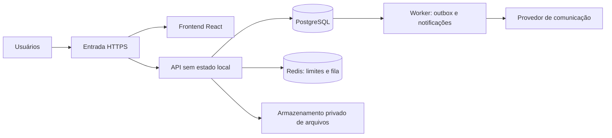

# Evolução do Emprego Social

## Escopo e evidências

Análise estática em 10/10/2026 do código em `/Users/augustojoselg/github/adote1desempregado`. Não foram executados testes, inspeção de produção ou auditoria de dependências. O site público não pôde ser acessado pela ferramenta de navegação. Este documento propõe trabalho; não representa uma implementação ou certificação de segurança.

## Diagnóstico prioritário

| Prioridade | Evidência no código | Ação |
| --- | --- | --- |
| Alta | `app/src/api.js` guarda token no localStorage; `backend/src/middleware/auth.js` não verifica expiração | Implementar identidade verificável, sessões expirantes, revogação e recuperação de acesso |
| Alta | `routes/users.js` retorna todo o diretório a qualquer conta, sem paginação | Definir visibilidade por campo, relacionamento e finalidade; limitar consultas |
| Alta | `routes/auth.js` permite escolher Empresa sem verificação | Separar pessoa, organização e membros; aprovar empresas antes de publicar |
| Alta | `db.js` usa arquivo SQLite local | Migrar para PostgreSQL antes de múltiplas réplicas; não compartilhar arquivo SQLite entre pods |
| Alta | Exclusão em `routes/account.js` limpa perfil, mas preserva vagas, nomes de empresas e vínculos | Inventariar dados derivados e definir exclusão, retenção e tratamento de backups |
| Média | `routes/elos.js` cria elo imediatamente e permite qualquer mudança entre estados | Adicionar convite, aceite, recusa, encerramento e transições validadas |
| Média | Limitação de requisições usa memória do processo | Aplicar limites coordenados entre réplicas e proteção específica para autenticação |
| Média | `LGPD.md` descreve versão anterior sem backend | Atualizar inventário e política a partir do comportamento efetivo |

Pontos positivos: consultas parametrizadas, validação com Zod, Helmet, hash de tokens, registro de consentimento e autorização de participantes para atualizar elos. Preservar e ampliar esses controles.

## Arquitetura proposta

Manter React e evoluir Express como monólito modular, com módulos de identidade, perfis, organizações, elos, vagas, comunicação e administração. Separar processos de API e worker, aproveitando os mesmos módulos de domínio.

PostgreSQL será a fonte de verdade. Gravar eventos de comunicação na mesma transação da operação de negócio usando outbox. O worker deve suportar retries com atraso, idempotência, falhas permanentes e reprocessamento controlado. Redis não será a única cópia de mensagens importantes.

## Permissões e controle dos dados

- Profissional: gerenciar perfil, visibilidade, candidaturas e próprios elos; autorizar compartilhamentos específicos.
- Mentor: visualizar informações liberadas e acompanhar elos aceitos; não acessar documentos privados de outros profissionais.
- Empresa: membros com papéis distintos; gerenciar vagas e candidaturas da própria organização, sem acesso geral a currículos.
- Operação: moderar cadastros e denúncias com permissões restritas e ações auditadas.
- Administração: MFA obrigatório, menor privilégio e acesso excepcional a dados pessoais registrado.

Validar autorização no servidor por recurso, organização e campo, em todas as operações. Não confiar em IDs ou papéis enviados pelo frontend. Implementar testes cruzando duas empresas e usuários sem relacionamento.

Modelo inicial: contas, sessões, perfis, organizações, membros, convites de elo, histórico de estados, vagas, candidaturas, conversas, participantes, mensagens, preferências, eventos de entrega, registros de privacidade e auditoria. Aplicar chaves estrangeiras, índices, restrições únicas e transações para impedir duplicações concorrentes.

## Comunicação e experiência

Separar páginas públicas de áreas autenticadas. Criar jornadas específicas para profissionais, mentores e empresas, com próximos passos claros, estados vazios úteis e navegação móvel acessível.

Começar com notificações internas e e-mail transacional. Incluir confirmação de convite, lembretes configuráveis, atualização de candidatura e acompanhamento de recolocação. WhatsApp depende da escolha de provedor e das preferências do destinatário.

Evitar currículos, contatos e informações sensíveis no corpo das notificações externas; direcionar ao sistema autenticado. Registrar envio, entrega, falha e leitura quando o canal permitir, sem tratar entrega como prova de leitura. Incluir bloqueio, denúncia e limites contra assédio e spam.

## Segurança da aplicação

Escolher autenticação gerenciada com OIDC ou fluxo próprio revisado. Para sessões em cookies, usar HttpOnly, Secure, SameSite adequado e proteção CSRF; definir expiração, rotação e logout de todos os dispositivos. Exigir verificação de e-mail e MFA para acessos privilegiados.

Restringir URLs externas a protocolos permitidos. Para futuros uploads, validar tamanho e tipo, verificar conteúdo e usar links temporários com autorização prévia. Não registrar tokens, currículos ou corpos de mensagens nos logs. Mapear finalidades, bases de tratamento, retenção e processos de atendimento ao titular com responsáveis definidos; checkbox de consentimento não resolve sozinho a governança dos dados.

## Kubernetes e operação

- Deployments independentes de frontend, API e worker; API sem arquivos ou sessões locais.
- Entrada HTTPS com controlador mantido e configuração explícita de proxies confiáveis.
- Containers sem root, filesystem somente leitura, capabilities removidas, seccomp e sem montagem automática de token de ServiceAccount quando desnecessário.
- NetworkPolicies com negação padrão e liberações específicas; confirmar suporte do CNI.
- Segredos externos, rotação e RBAC mínimo; não colocar credenciais em manifests ou imagens.
- Requests e limits, probes separadas de liveness/readiness, desligamento gracioso e PodDisruptionBudget compatível com o número de réplicas.
- Autoscaling da API por métricas; workers por demanda da fila. Validar capacidade do banco e pools de conexões durante escala.
- Banco preferencialmente gerenciado, com backups criptografados e restauração ensaiada. Definir RPO/RTO antes de produção.
- Migrações versionadas em Job único de release; alterações compatíveis com versões coexistentes durante rollout.
- CI com testes, análise de dependências, varredura de segredos e imagens; imagens imutáveis e rollback documentado.
- Métricas de erros, latência, fila, entregas e banco; logs estruturados e alertas com responsáveis.

## Entregas e critérios de aceite

1. **Fundação:** trazer uma cópia do código para a área de trabalho permitida, registrar baseline, adicionar testes de autorização e fechar regras de negócio e hospedagem.
2. **Identidade e dados:** PostgreSQL, migrações, autenticação recuperável, sessões revogáveis e isolamento entre organizações. Aceite: tentativas de acesso cruzado negadas e migração reconciliada por contagens e integridade.
3. **Fluxos:** convites aceitos, candidaturas, comunicação com outbox e moderação. Aceite: retries não duplicam notificações e mudanças inválidas de estado são rejeitadas.
4. **Experiência:** site e painéis por papel; validar navegação móvel, teclado e tarefas essenciais com usuários.
5. **Operação:** containers, ambiente de homologação e Kubernetes. Aceite: teste com pelo menos duas réplicas, interrupção de pod sem perda de operações confirmadas, restauração de backup e ensaio de rollback.

Metas de carga, disponibilidade, retenção, custos e recuperação dependem de volume e provedor. Não declarar prontidão para produção sem testes de carga e recuperação e revisão dos acessos.

## Referências

- [Kubernetes — Security Checklist](https://kubernetes.io/docs/concepts/security/security-checklist/)
- [OWASP — autorização por objeto](https://api-security.owasp.org/editions/2023/en/0xa1-broken-object-level-authorization/)
- [OWASP — autorização por propriedade](https://api-security.owasp.org/editions/2023/en/0xa3-broken-object-property-level-authorization/)

## Execução local — 10/10/2026

Baseline: commit `49a3a45b4a99ede27790bf546df09909b2551968`, árvore inicialmente limpa. Implementação diretamente na cópia autorizada `/Users/augustojoselg/github/adote1desempregado`; não foi necessário duplicar o código.

Entregue parcialmente o primeiro ciclo: aplicação separada do processo HTTP, testes de integração com contas distintas, sessão expira em sete dias e logout revoga token, armazenamento provisório em sessionStorage, consultas limitadas, dados de perfil de terceiros restritos, URLs HTTP/HTTPS, transições sequenciais de elo e exclusão transacional de perfil e dados derivados. Inventário de privacidade atualizado.

Não concluído: regras de negócio e hospedagem; PostgreSQL e reconciliação de migração; identidade recuperável e verificada; cookies protegidos; organizações e membros com aprovação; convites com aceite; candidaturas; outbox e notificações; moderação; paginação na interface; painéis por papel e validação de acessibilidade; infraestrutura, homologação, duas réplicas, carga, backups e rollback. Os controles provisórios não satisfazem os critérios de aceite das etapas 2–5.

Decisões necessárias para implantação: provedor de identidade, hospedagem, banco e comunicação; domínio e origem da API; responsáveis pela aprovação de empresas e privacidade; retenção, RPO/RTO e volume esperado. Não houve deploy ou alteração de produção.

Validação executada: `backend/npm ci`, `backend/npm test` (integração aprovada), `app/npm ci`, `app/npm run build` (aprovado) e `git diff --check` (sem erros). Não foram executados testes de produção, carga, restauração ou acessibilidade.

### Containers — entrega local

Adicionados Dockerfiles em estágios para API e frontend, proxy Nginx configurável em runtime, Compose com persistência SQLite, healthchecks, usuários sem root e filesystem somente leitura. API fecha conexões e banco no desligamento com prazo máximo. Testes da API aprovados em Linux ARM64 e AMD64; teste funcional do Compose aprovou proxy e persistência após recriação. Instruções em DOCKER.md. Esta entrega cobre empacotamento local da etapa 5; Kubernetes, homologação, banco compartilhado, restauração, carga e rollback continuam pendentes.

### PostgreSQL e preparação Azure

O runtime SQLite foi substituído por PostgreSQL 17; rotas usam operações assíncronas, transações e restrição única de elos. Migrações versionadas explícitas com advisory lock; exportação/importação legada com contagens e transação. Cookies HttpOnly e Secure em produção, validação de origem para CSRF e ausência de token no JSON de produção. Bicep preparado com PostgreSQL privado/Entra sem senha, identidades separadas, Key Vault restrito e Container Apps Consumption. Consulte infra/azure/README.md para custos e procedimento. Testes locais PostgreSQL e persistência aprovados. Ainda faltam validação da identidade na nuvem, restauração, rollback, login verificável/recuperável e demais critérios de produção.

### Implantação autorizada e operação — 10/10/2026

Provisionamento autorizado pelo responsável. Dependências da API e frontend corrigidas; auditorias sem vulnerabilidades conhecidas na consulta; Vite 8 e build aprovados. Política exibida alinhada à visibilidade, exclusão e retenção efetivas, versão 1.1.0. Respostas da API usam no-store; frontend trata falhas nas operações de conta e elos. CI com actions fixadas por SHA valida testes, build e auditoria, sem credenciais Azure/GitHub na configuração. Guias de usuários, administradores e plano de adoção em docs/. Situação real da implantação e limitações em infra/azure/IMPLANTACAO.md; ainda não há declaração de produção pública pronta.
