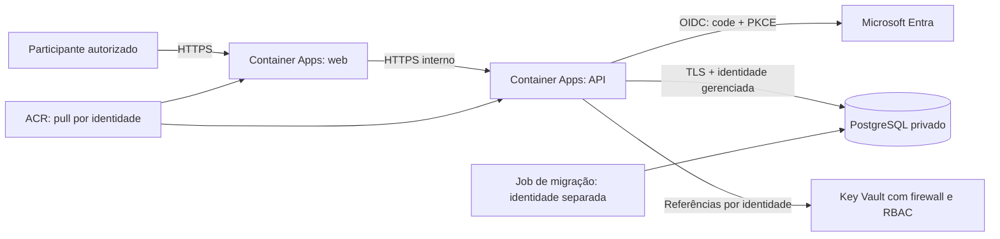

# Azure — PostgreSQL privado e login Entra

Implantação autorizada em `rg-adote1`, região `centralus`, prefixo `adote1p`. Consulte [IMPLANTACAO.md](IMPLANTACAO.md) para o estado observado, endereço e verificações. O ACR existente `adote1`, em East US, foi reduzido para Basic; usuário administrador desabilitado. Imagens por digest em [ACR.md](../../ACR.md).

## Arquitetura



Container Apps Consumption: web e API com 0,25 vCPU/0,5 GiB cada, mínimo zero e máximo uma réplica. Há cold start e indisponibilidade durante falhas dessa única réplica. PostgreSQL Flexible Server 17 B1ms, 32 GB, backup de sete dias, sem HA nem redundância geográfica. A API tem ingresso interno; o banco tem publicNetworkAccess=Disabled e passwordAuth=Disabled. A subnet PostgreSQL preserva o service endpoint Microsoft.Storage exigido pelo serviço.

O frontend começa restrito ao IP do operador. Depois dos testes, `restrictWebToOperator=false` publica a página HTTPS de login; dados pessoais continuam exigindo autenticação Entra. `operatorIpv4` permanece limitando a administração do Key Vault mesmo nessa configuração.

Key Vault Standard usa RBAC, purge protection e soft delete de 90 dias. Firewall nega por padrão, permite a subnet dos apps por service endpoint e o IP administrativo. O endereço segue público, com acesso de rede restrito. Private endpoints, ACR Premium e proteção de borda são alternativas com custos adicionais.

## Identidades, autenticação e segredos

| Identidade | Permissões |
| --- | --- |
| web-mi | AcrPull; indisponível ao processo web, lifecycle None |
| api-mi | AcrPull; leitura dos dois segredos OIDC; DML do app; INSERT/SELECT da auditoria |
| migrate-mi | AcrPull; administrador Entra do PostgreSQL para bootstrap e migrações |
| operador | Key Vault Secrets Officer no vault; administração de segredos limitada ao seu IP |

Banco e ACR não usam senhas. ManagedIdentityCredential obtém token Entra para cada nova conexão PostgreSQL; TLS verifica o certificado. A identidade da API não tem DDL nem permissão de alterar/apagar a auditoria administrativa. O job privilegiado é manual e separado da API.

O login de usuários usa aplicação web Entra single-tenant, código de autorização, PKCE S256, estado, nonce, assinatura, issuer e audience validados. A atribuição ao aplicativo é obrigatória. Papéis Member, Company e Admin são controlados no Entra; somente Company/Admin autoriza cadastro empresarial. Contas externas entram como convidadas B2B autorizadas. Não há autocadastro público irrestrito.

A API guarda hash de sessão; cookie HttpOnly, Secure, SameSite=Strict, expiração de 24 horas. Novo login revoga a sessão anterior; logout, suspensão e revogação administrativa invalidam acesso. Cookies temporários OIDC/registro usam SameSite=Lax para o retorno do provedor, AES-256-GCM e validade de dez minutos. Não há tokens Microsoft ou refresh tokens persistidos no app, no banco ou no navegador. OIDC não solicita escopo de e-mail nem acesso ao Microsoft Graph. A recuperação da conta acontece pelo provedor Microsoft. A aplicação não exige MFA por código; a política de MFA deve ser configurada no tenant conforme licenças e responsáveis.

Os dois segredos necessários são `oidc-client-secret` e `oidc-cookie-key`, somente no Key Vault e na memória do processo autorizado. Bicep/JSON contêm nomes, client ID e referências, nunca valores. `scripts/azure-identity-bootstrap.py` grava por arquivos temporários privados 0600, captura a resposta da credencial sem exibi-la e remove arquivos ao terminar. Se a gravação falhar, tenta revogar a credencial recém-criada. A credencial OIDC expira em 180 dias; a expiração também é registrada no Key Vault.

Logs usam Azure Monitor sem shared keys no template. Nginx não registra query string, cookies ou Authorization. Erros da API não imprimem corpos, tokens ou stacks. Logs podem conter IP e identificadores técnicos: limite acesso e retenção. Administradores ainda conseguem acessar dados e segredos conforme suas permissões; não há promessa de segurança absoluta.

## Custos estimados

Consulta Azure Retail Prices em 10/10/2026, Central US, USD, sem descontos ou impostos. Snapshot em [cost-estimate.json](cost-estimate.json); atualize com `python3 scripts/azure-costs.py centralus`.

| Item | Estimativa mensal |
| --- | --- |
| PostgreSQL B1ms, 730 h × US$0,01921 | US$14,02 |
| PostgreSQL, 32 GB × US$0,13 | US$4,16 |
| ACR Basic, 30 dias × US$0,1666 | US$5,00 |
| Subtotal fixo desses itens | **US$23,18** |

A redução do ACR economiza cerca de US$15/mês contra Standard; havia aproximadamente 127 MB de uso na verificação. O subtotal exclui Container Apps, rede/IPs gerenciados, DNS, logs, egress, backups excedentes, operações Key Vault, impostos e câmbio. Dois containers continuamente ativos no tamanho definido representam aproximadamente US$39,42/mês de compute bruto antes da franquia compartilhada da assinatura. Scale-to-zero não desliga PostgreSQL.

O workspace retém 30 dias e tem quota de 0,1 GB/dia. Isso pode interromper logs e não é teto financeiro rigoroso. Orçamento e destinatários de alertas ainda precisam ser definidos. Alertas de orçamento não desligam recursos. A configuração econômica não inclui AKS, NAT Gateway, Firewall, Bastion, Front Door ou WAF.

## Implantação em etapas

Requer CLI Azure, compilador Bicep, Docker, autorização RBAC e permissão Entra para registrar o aplicativo e atribuir usuários. East US e East US 2 apresentaram restrição de oferta nesta assinatura; Central US retornou PostgreSQL 17 e Standard_B1ms permitidos. O script consulta versões antes de aplicar; validate não reserva capacidade.

1. Registre uma aplicação Entra single-tenant e seu service principal. Copie parameters.example.json para parameters.local.json, ignorado pelo Git. Informe client ID, digests, IP e object ID do operador. Não substitua referências OIDC por valores.
2. Comece com enableApplication=false. Se a quota de ambiente estiver ocupada por exclusão pendente, use enableContainerEnvironment=false para adiantar banco, rede e identidades; depois volte para true. O modo Incremental não remove recursos condicionais já existentes.
3. Execute os testes locais e publique imagens com uma tag inédita. Não sobrescreva tags; registre os digests.
4. Compile Bicep, execute validate e plan, e só então apply.

```sh
docker compose --profile test run --build --rm test
bash scripts/azure-deploy.sh validate
bash scripts/azure-deploy.sh plan
bash scripts/azure-deploy.sh apply
```

Se o compilador não estiver integrado à CLI, defina `BICEP_BIN=/caminho/do/bicep`. Os comandos apply criam recursos faturáveis e permissões. Se o administrador Entra do banco falhar porque o servidor ainda não está acessível, aguarde Ready e reaplique; nunca habilite senha ou rede pública para contornar a falha.

5. Após criar o vault, configure o aplicativo Entra e grave os segredos. Os argumentos são identificadores públicos:

```sh
python3 scripts/azure-identity-bootstrap.py \
  --application-object-id OBJECT_ID_DO_APLICATIVO \
  --service-principal-id OBJECT_ID_DO_SERVICE_PRINCIPAL \
  --operator-object-id OBJECT_ID_DO_OPERADOR \
  --vault-name NOME_DO_VAULT
```

6. Com o ambiente criado, consulte defaultDomain. No registro Entra, autorize somente a redirect URI exata `https://adote1p-web.DOMINIO_DO_AMBIENTE/api/auth/callback`, com implicit grant desabilitado. O bootstrap atribui Admin ao operador; valide MFA e demais acessos no portal.
7. Execute o job manual e aguarde Succeeded antes de habilitar apps:

```sh
az containerapp job start --name adote1p-migrate --resource-group rg-adote1
az containerapp job execution list --name adote1p-migrate --resource-group rg-adote1 -o table
```

O job cria a role runtime pelo object ID, migra esquema com advisory lock e transação e concede permissões mínimas. Não dá autorização de usuário da aplicação nem importa SQLite.

8. Defina enableApplication=true e faça validate/plan/apply. Teste primeiro com restrictWebToOperator=true. O smoke abaixo não cria contas nem contorna o Entra:

```sh
APP_ORIGIN=https://ENDERECO.azurecontainerapps.io node scripts/azure-smoke.mjs
```

9. Valide interativamente login, consentimento, retorno à mesma conta, autorização empresarial, administração, logout e recuperação com contas de teste autorizadas. Verifique que API e banco não aceitam acesso público direto e que runtime não tem DDL. Ensaie backup/restore e carga antes de admitir dados reais. Depois dos controles aprovados, restrictWebToOperator=false libera a página de login HTTPS mantendo autorização por Entra.

## Rotação, rollback e dados legados

Antes de 180 dias, execute o bootstrap com `--rotate-client-secret`; ele grava uma nova versão no Key Vault. Confirme atualização da revisão, teste login e só então revogue a credencial anterior no Entra. Rotacionar `--rotate-cookie-key` invalida retornos de login pendentes; sessões já emitidas seguem sua expiração/revogação. Não use tracing nem copie valores do Key Vault para arquivos versionados.

Rollback usa imagem PostgreSQL anterior **compatível com o esquema e o requisito Entra atual**. Imagens v1 SQLite e v2 anteriores ao login obrigatório não são rollback seguro para produção. Voltar uma imagem não desfaz SQL. Procedimentos de recuperação e exclusões em [guia administrativo](../../docs/GUIA-ADMINISTRADORES.md).

Não há importação automática de dados legados. Com escritas interrompidas, `python3 scripts/export-sqlite.py /origem/adote.db /local-protegido/backup.sqlite-export.json` gera snapshot privado. O importador PostgreSQL exige destino vazio e valida contagens/FKs em transação. Execute somente em runner autorizado na VNet, com arquivo privado e temporário. Ele invalida sessões antigas; o vínculo com identidades Entra deve ser definido e testado antes de admitir usuários legados. Não abra o banco à Internet para importar dados.

## Evidências e limites

Quatro testes locais aprovados: autorização/privacidade, cookies/CSRF, OIDC com provedor simulado e JWT assinado, migrações/transações. Teste de build AMD64 aprovado; auditorias npm sem vulnerabilidades conhecidas na consulta. O teste OIDC simulado não substitui login interativo no tenant real. CI usa actions fixadas por SHA, permissões contents:read e nenhum segredo de deploy. Situação na nuvem em IMPLANTACAO.md.

Convite de elo com aceite, moderação/edição de vagas, notificações, candidaturas internas, rate limit distribuído e HA continuam fora da versão atual. O sistema opera inicialmente com participantes autorizados e acordo prévio de mentoria. Domínio personalizado, responsáveis, retenção administrativa, orçamento, alertas, RPO/RTO e capacidade devem ser formalizados. Não declarar produção pública plenamente validada apenas porque o deploy terminou.

## Fontes oficiais

- [Fluxo Microsoft de código de autorização](https://learn.microsoft.com/en-us/entra/identity-platform/v2-oauth2-auth-code-flow)
- [Atribuição de usuários ao aplicativo](https://learn.microsoft.com/en-us/entra/identity/enterprise-apps/assign-user-or-group-access-portal)
- [PostgreSQL com identidade gerenciada](https://learn.microsoft.com/en-us/azure/postgresql/security/security-connect-with-managed-identity)
- [PostgreSQL em rede privada e endpoint Storage](https://learn.microsoft.com/en-us/azure/postgresql/network/concepts-networking-private)
- [Key Vault: service endpoints e firewall](https://learn.microsoft.com/en-us/azure/key-vault/general/overview-vnet-service-endpoints)
- [Container Apps: referência a Key Vault](https://learn.microsoft.com/en-us/azure/container-apps/manage-secrets)
- [Cobrança Container Apps](https://learn.microsoft.com/en-us/azure/container-apps/billing)
