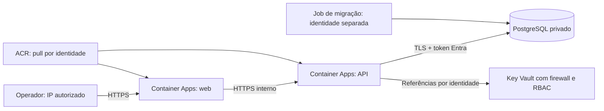

# Azure — configuração econômica com PostgreSQL e identidades

Implantação autorizada em andamento, com acesso inicialmente restrito. Consulte [IMPLANTACAO.md](IMPLANTACAO.md) para o resultado observado. O ACR existente é reutilizado; imagens SQLite v1 são incompatíveis com PostgreSQL.

## Validação realizada em 10/10/2026

- Testes da API com PostgreSQL, sessões de produção e transações: 3 testes aprovados.
- Smoke test Docker aprovado, incluindo persistência após recriar os containers e exclusão da conta de teste.
- Imagens AMD64 `v2-pg-20261010-03` publicadas e digests conferidos no ACR; consulte [ACR.md](../../ACR.md).
- Bicep compilado e `az deployment group validate` concluído sem erro com aplicação inicialmente desabilitada.
- `what-if` retornou `Succeeded`, criação da infraestrutura e preservação do registry existente. O administrador Entra do PostgreSQL apareceu como `Unsupported` na análise porque seu identificador depende da identidade gerenciada ainda não criada. Isso exige verificação durante a implantação; não é uma confirmação de funcionamento da autenticação.

A conectividade privada, a autenticação das identidades e a restauração de backup ainda precisam ser testadas no Azure após provisionamento. Os parâmetros locais estão fora do Git; confira o IP autorizado antes de aplicar. Após autorização, iniciou-se o provisionamento; há recursos faturáveis. O registro da implantação distingue o que foi criado e o que ainda falta validar.

## Arquitetura



Container Apps Consumption: web e API com 0,25 vCPU/0,5 GiB cada, mínimo zero e máximo uma réplica para limitar consumo. Pode haver cold start. API com ingresso interno; só web tem ingresso externo, restrito ao IPv4 do operador. O PostgreSQL Flexible Server 17 usa B1ms, 32 GB, backup de sete dias e rede privada. Não há HA ou redundância geográfica nesta configuração econômica.

Key Vault Standard usa RBAC, purge protection e soft delete de 90 dias. Firewall nega por padrão, permite o subnet dos apps por service endpoint e o IP administrativo informado. O endereço do vault segue público, mas não aceita acesso de redes arbitrárias. Private endpoints e ACR Premium são alternativas com custo adicional, não requisitos para evitar senhas fixas.

## Identidades e segredos

| Identidade | Permissões |
| --- | --- |
| web-mi | AcrPull; identidade indisponível ao processo web (lifecycle None) |
| api-mi | AcrPull; leitura apenas dos secrets explicitamente referenciados; DML nas tabelas do app |
| migrate-mi | AcrPull; administrador Entra do PostgreSQL para bootstrap e migrações |
| operador | Key Vault Secrets Officer no vault; firewall limitado ao seu IP |

A aplicação não recebe senha do banco nem senha do ACR. ManagedIdentityCredential solicita tokens Entra para novas conexões PostgreSQL. TLS verifica o certificado do servidor. O frontend não recebe esses tokens. Os IDs das identidades, hostname e nome do banco são configuração pública, não credenciais.

Key Vault fica inicialmente vazio: não é necessário inventar um segredo para um serviço que já aceita identidade. Para SMTP ou outro provedor que exija uma chave, grave o valor diretamente no Key Vault por ferramenta autorizada e use `runtimeSecrets` com apenas nome e nome da variável. Não coloque valores em parâmetros, CLI com tracing, outputs ou imagens. O Bicep concede leitura em cada secret, não no vault inteiro. Revise a rotação e a atualização efetiva das revisões após trocar uma credencial.

Logs usam Azure Monitor por referência ao workspace, sem expor shared keys do Log Analytics. A API registra categoria de erro, sem stack, parâmetros, corpos ou tokens; Nginx exclui query string, cookies e Authorization do formato de acesso. Operadores com acesso ao processo ou permissões administrativas ainda podem acessar dados e tokens temporários; Key Vault não elimina esse risco. Restrinja RBAC, exija MFA e revise acessos.

## Custos estimados

Consulta à API pública Azure Retail Prices em 10/10/2026, região centralus, USD, sem descontos contratuais ou impostos. Detalhes em [cost-estimate.json](cost-estimate.json); atualização com `python3 scripts/azure-costs.py centralus`.

| Item | Estimativa |
| --- | --- |
| PostgreSQL B1ms, 730 horas × US$0,01921 | US$14,02/mês |
| PostgreSQL, 32 GB × US$0,13 | US$4,16/mês |
| ACR Standard (comparação), 30 dias × US$0,6666 | US$20,00/mês |
| Subtotal fixo acima | **US$38,18/mês** |
| ACR Basic atual, 30 dias × US$0,1666 | US$5,00/mês |
| Subtotal com Basic | **US$23,18/mês** |

Esses subtotais não incluem Container Apps, rede/IPs gerenciados, logs, egress, backup excedente e operações Key Vault. O custo final depende do tráfego e do tempo ativo; não há garantia de gratuidade. Container Apps possui franquia mensal compartilhada por assinatura. Após a franquia, os medidores consultados são US$0,000024/vCPU-segundo e US$0,000003/GiB-segundo. Dois containers continuamente ativos nesse tamanho representam aproximadamente US$39,42/mês de compute bruto antes da franquia, além dos itens fixos.

O workspace retém 30 dias e tem quota de ingestão de 0,1 GB/dia; esse limite não é teto financeiro rigoroso e pode interromper logs. Configure orçamento e alertas no Cost Management; teto e destinatários ainda precisam ser definidos. Orçamentos alertam; não desligam automaticamente recursos. PostgreSQL permanece faturável sem tráfego; o scale-to-zero só se aplica aos apps.

A troca do ACR Standard para Basic foi executada após conferir aproximadamente 127 MB de uso, economizando cerca de US$15/mês nos medidores consultados. Revise throughput e armazenamento conforme o crescimento. Não criar AKS, NAT Gateway, Firewall, Bastion ou Front Door para este piloto reduz custos fixos, com limitações de proteção de borda e disponibilidade descritas abaixo.

## Pré-requisitos e região

Assinatura: e7ab0c25-090c-4159-b2c2-9d401e356796. Grupo: rg-adote1. ACR: adote1.

East US 2 passou na validação inicial, mas falhou durante a criação: a consulta atual retornou OfferRestricted=Enabled e nenhuma versão disponível. Central US retornou PostgreSQL 17 e Standard_B1ms permitidos; é a região padrão atual. O prefixo adote1p separa a implantação definitiva dos recursos provisórios adote1. O script confere versões permitidas antes de criar recursos; validate não reserva capacidade. Tráfego para o ACR em eastus pode ter cobrança entre regiões.

O operador de deploy precisa de permissão para criar os recursos e atribuir papéis. A identidade cotidiana da aplicação não deve receber Owner/Contributor. CLI Azure, compilador Bicep, Docker e acesso ao ACR são necessários. Informe seu IPv4 público autorizado e object ID Entra; nenhum segredo é solicitado.

## Publicar a nova versão e revisar

Na raiz, execute testes e publique com uma nova tag, nunca sobrescrevendo v1:

```sh
docker compose --profile test run --build --rm test
az acr login --name adote1
# Use uma tag ainda não utilizada; o exemplo abaixo é a primeira versão PostgreSQL.
docker buildx build --platform linux/amd64 -f backend/Dockerfile -t adote1-emajexd8e5cvf4b9.azurecr.io/emprego-social/api:v2-pg-20261010-03 --push .
docker buildx build --platform linux/amd64 -f app/Dockerfile -t adote1-emajexd8e5cvf4b9.azurecr.io/emprego-social/web:v2-pg-20261010-03 --push .
```

Obtenha os digests com `az acr repository show --name adote1 --image emprego-social/api:TAG --query digest -o tsv`, repetindo para web. Copie parameters.example.json para parameters.local.json, substitua digests, IPv4 e object ID. O arquivo local está no gitignore. Mantenha enableApplication=false na primeira execução. Se a assinatura estiver com a quota de ambiente ocupada por uma exclusão pendente, enableContainerEnvironment=false permite adiantar banco, rede e identidades. Depois que a quota liberar, volte para true e aplique para criar ambiente e job antes de habilitar a aplicação. Recursos condicionais omitidos no modo Incremental não são apagados.

```sh
az bicep build --file infra/azure/main.bicep --outfile /tmp/adote1-template.json
bash scripts/azure-deploy.sh validate
bash scripts/azure-deploy.sh plan
```

Se Bicep não estiver integrado à CLI, use `BICEP_BIN=/caminho/do/bicep bash scripts/azure-deploy.sh plan`. Examine os recursos e custos antes de aplicar. Os comandos seguintes criam recursos faturáveis e permissões:

```sh
bash scripts/azure-deploy.sh apply
az containerapp job start --name adote1p-migrate --resource-group rg-adote1
az containerapp job execution list --name adote1p-migrate --resource-group rg-adote1 --output table
```

Espere o job terminar com Succeeded. Se falhar, não habilite os apps. Confira logs pelo Azure Monitor; não habilite logging de tokens ou dumps de ambiente. O job cria a role Entra pelo object ID, aplica SQL com advisory lock/transação e concede permissões de dados ao runtime. A identidade de migração fica no job, não na API.

Depois, mude enableApplication=true em parameters.local.json e execute novamente validate, plan e apply. Confira o output webOrigin, healthchecks, readiness e cookies HTTPS pelo IP autorizado. Execute `APP_ORIGIN=https://ENDERECO.azurecontainerapps.io node scripts/azure-smoke.mjs` na máquina autorizada; o teste usa dados fictícios e limpa as contas. Teste que a API não é acessível externamente e que o banco não tem rota pública. Confirme que a identidade runtime não consegue executar DDL. Antes do uso real, realize restauração de backup e rollback com uma imagem anterior **compatível com PostgreSQL**; as imagens SQLite v1 não são rollback válido.

## Dados legados

Não há cópia automática de SQLite para Azure. Preserve o volume e crie backup consistente antes de migrar. Com escritas interrompidas, use:

```sh
python3 scripts/export-sqlite.py /origem/adote.db /local-protegido/backup.sqlite-export.json
```

O importador `backend/src/import-sqlite.js` exige banco PostgreSQL migrado e vazio, executa tudo em transação e valida contagens e FKs. Executar com identidade de migração em um runner autorizado na VNet, montando o arquivo de forma privada e temporária. Não publicar esse arquivo na imagem, no Git, no stdout ou em blob público. Não abrir o banco à Internet para facilitar a importação. Teste primeiro numa cópia; duplicações antigas de elos podem violar a nova restrição única e causar rollback.

A importação invalida tokens antigos; o vínculo dessas contas com um login verificável e recuperável precisa ser definido antes de disponibilizar dados aos titulares.

## Limites que impedem abertura pública agora

O app ainda não possui identidade de usuário verificável, recuperação de conta, aprovação de empresas ou aceite de convite. Cookies protegidos e Key Vault não resolvem esses fluxos. Por isso o template abre somente homologação por IP e não inclui um botão ou parâmetro de abertura irrestrita. Não remova a restrição antes de resolver essas lacunas e rever LGPD.

Não há WAF, HA do banco, banco em múltiplas zonas, rate limit distribuído ou autoscaling além de uma réplica. Há egress necessário aos serviços Azure; um ambiente estritamente privado exige endpoints e controles adicionais com custo. Não há promessa de segurança absoluta ou prontidão de produção. DNS personalizado, orçamento, alertas, restauração e aprovação dos acessos devem ser concluídos no ambiente.

## Fontes oficiais

- [PostgreSQL com identidade gerenciada](https://learn.microsoft.com/en-us/azure/postgresql/security/security-connect-with-managed-identity)
- [PostgreSQL em rede privada](https://learn.microsoft.com/en-us/azure/postgresql/network/concepts-networking-private)
- [Key Vault: service endpoints e firewall](https://learn.microsoft.com/en-us/azure/key-vault/general/overview-vnet-service-endpoints)
- [Container Apps: referência a Key Vault](https://learn.microsoft.com/en-us/azure/container-apps/manage-secrets)
- [Disponibilidade de identidade no processo](https://learn.microsoft.com/en-us/azure/container-apps/managed-identity)
- [Cobrança Container Apps](https://learn.microsoft.com/en-us/azure/container-apps/billing)
- [Preços públicos Azure](https://learn.microsoft.com/en-us/rest/api/cost-management/retail-prices/azure-retail-prices)
